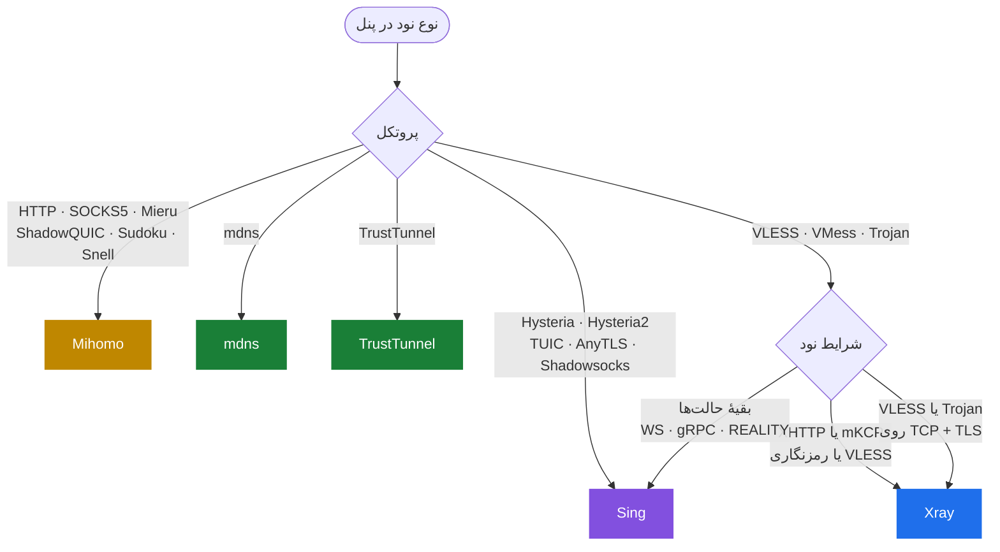

<div align="center">

# V2bX — DrMobile Fork

**سرویس نود چندهسته‌ای برای پنل Irboard / V2board**
<br>
A multi-core node server for Irboard / V2board panels

[](https://github.com/PoriyaVali/V2bX/releases)
[](https://github.com/PoriyaVali/V2bX/actions)
[](LICENSE)

[نصب آسان](#-نصب-آسان) · [نصب دستی](#-نصب-دستی) · [قابلیت‌ها](#-قابلیتها) · [هسته‌ها و پروتکل‌ها](#-هستهها-و-پروتکلها) · [mdns](#-mdns-تونل-dns) · [TrustTunnel](#-trusttunnel) · [دستورها](#-دستورها) · [English](#-english-summary)

</div>

---

<div dir="rtl">

V2bX روی سرور نود نصب می‌شود، تنظیمات و فهرست کاربران را از پنل می‌گیرد و مصرف هر کاربر را به پنل گزارش می‌کند. یک برنامه است با **شش هسته**؛ هر نود را می‌توانید روی هسته‌ای بگذارید که برای پروتکلش مناسب‌تر است، و چند نود با هسته‌های مختلف کنار هم روی یک سرور کار می‌کنند.

منشعب از [wyx2685/V2bX](https://github.com/wyx2685/V2bX)، با هسته‌های به‌روز، منوی فارسی/انگلیسی و آزمون سرتاسری هر پروتکل روی هر هسته.

## 🚀 نصب آسان

یک دستور، با دسترسی root. اگر V2bX نصب باشد **به‌روزرسانی** می‌کند، وگرنه **نصب کامل** انجام می‌دهد و ویزارد تنظیم را باز می‌کند:

</div>

```bash
bash <(curl -Ls https://raw.githubusercontent.com/PoriyaVali/V2bX/dev_new/install.sh) setup
```

<div dir="rtl">

ویزارد فقط این‌ها را می‌پرسد: آدرس پنل، کلید ارتباط (API Key)، شناسهٔ نود و هسته. نوع پروتکل، TLS و دامنه را خودش از پنل می‌خواند. جزئیات در [راهنمای تنظیم خودکار](docs/automated-setup.md).

بعد از نصب، هر زمان:

</div>

```bash
v2bx menu      # منوی مدیریت
v2bx update    # به‌روزرسانی به آخرین نسخه
```

<div dir="rtl">

در به‌روزرسانی، فایل‌های تنظیم و گواهی‌ها دست نمی‌خورند. سرویسِ روشن دوباره راه‌اندازی می‌شود و سرویسِ خاموش، خاموش می‌ماند. اگر دانلود ناقص باشد یا نسخه پیدا نشود، نسخهٔ نصب‌شده تغییری نمی‌کند.

## 🛠 نصب دستی

برای وقتی که نمی‌خواهید اسکریپت نصب را اجرا کنید.

**۱. دانلود باینری** از [صفحهٔ انتشارها](https://github.com/PoriyaVali/V2bX/releases/latest). نام فایل بر اساس معماری سرور:

</div>

| معماری (`uname -m`) | فایل |
|---|---|
| `x86_64` | `V2bX-linux-64.zip` |
| `aarch64` | `V2bX-linux-arm64-v8a.zip` |
| `armv7l` | `V2bX-linux-arm32-v7a.zip` |
| `riscv64` | `V2bX-linux-riscv64.zip` |
| `s390x` | `V2bX-linux-s390x.zip` |

```bash
mkdir -p /usr/local/V2bX /etc/V2bX
wget -O /tmp/V2bX.zip https://github.com/PoriyaVali/V2bX/releases/latest/download/V2bX-linux-64.zip
unzip -o /tmp/V2bX.zip -d /usr/local/V2bX
chmod +x /usr/local/V2bX/V2bX
ln -sf /usr/local/V2bX/V2bX /usr/bin/v2bx
```

<div dir="rtl">

**۲. فایل تنظیم.** نمونه‌ها در پوشهٔ [example](example/) هستند. کمترین تنظیم برای یک نود:

</div>

```json
{
  "Log": { "Level": "info" },
  "Cores": [
    { "Type": "sing", "OriginalPath": "/etc/V2bX/sing_origin.json" }
  ],
  "Nodes": [
    {
      "Core": "sing",
      "ApiHost": "https://panel.example.com",
      "ApiKey": "کلید ارتباط پنل",
      "NodeID": 1,
      "NodeType": "vless",
      "ListenIP": "0.0.0.0",
      "CertConfig": {
        "CertMode": "http",
        "CertDomain": "node.example.com",
        "CertFile": "/etc/V2bX/node.example.com.crt",
        "KeyFile": "/etc/V2bX/node.example.com.key"
      }
    }
  ]
}
```

<div dir="rtl">

این را در `/etc/V2bX/config.json` بگذارید. `sing_origin.json`، `dns.json` و `route.json` را هم از پوشهٔ example در `/etc/V2bX` کپی کنید. به‌جای نوشتن دستی می‌توانید ویزارد را اجرا کنید: `v2bx configure`.

**۳. سرویس systemd:**

</div>

```bash
cat > /etc/systemd/system/V2bX.service <<'EOF'
[Unit]
Description=V2bX Service
After=network.target nss-lookup.target

[Service]
User=root
WorkingDirectory=/usr/local/V2bX
CapabilityBoundingSet=CAP_NET_ADMIN CAP_NET_BIND_SERVICE
AmbientCapabilities=CAP_NET_ADMIN CAP_NET_BIND_SERVICE
ExecStart=/usr/local/V2bX/V2bX server -c /etc/V2bX/config.json
Restart=on-failure
RestartSec=5s
LimitNOFILE=1048576

[Install]
WantedBy=multi-user.target
EOF
systemctl daemon-reload
systemctl enable --now V2bX
journalctl -u V2bX -f
```

<div dir="rtl">

دستور `v2bx` همان باینری است، پس با پیوندی که در گام ۱ ساختید منو و همهٔ دستورها را دارید. فقط نودهای TrustTunnel به برنامهٔ endpoint جدا نیاز دارند که اسکریپت نصب دانلودش می‌کند.

**ساخت از سورس** (Go 1.27.1):

</div>

```bash
git clone https://github.com/PoriyaVali/V2bX.git && cd V2bX
GOEXPERIMENT=jsonv2 go build -v -o V2bX \
  -tags "sing xray hysteria2 with_quic with_grpc with_utls with_wireguard with_acme with_gvisor mdns trusttunnel mihomo" \
  -trimpath -ldflags "-s -w -buildid="
```

<div dir="rtl">

## ✨ قابلیت‌ها

### مدیریت کاربران و مصرف

- **صورت‌حساب دقیق:** مصرف هر کاربر به پنل گزارش می‌شود، حتی ترافیکی که درست قبل از حذف کاربر مصرف شده.
- **قطع فوری:** کاربری که پنل حذف می‌کند، اتصال‌های بازش هم بسته می‌شود.
- **محدودیت سرعت** برای هر کاربر و هر نود، روی آپلود و دانلود.
- **محدودیت دستگاه و اتصال** برای هر کاربر، و گزارش دستگاه‌های آنلاین.
- **تغییر کاربران بدون قطع نود:** افزودن و حذف کاربر اتصال دیگران را قطع نمی‌کند.

### امنیت و فیلترینگ

- **قوانین پنل روی هر اتصال و هر بستهٔ UDP:** دامنه، آدرس، پورت و پروتکل مسدودشده.
- **مسدودسازی آدرس‌های خصوصی:** کاربر به سرویس‌های خود سرور و شبکهٔ داخلی آن نمی‌رسد.
- **سایت پوششی:** به کاوشگرها یک سایت واقعی نشان می‌دهد، نه خطای پروکسی. [توضیحات](docs/censorship-countermeasures.md) · [امنیت سایت پوششی](docs/cover-site-security.md)
- **مسدودسازی کشور** با GeoIP (هستهٔ Sing).

### شبکه و پایداری

- **DNS هوشمند:** اگر UDP سرور بسته گم کند، پرس‌وجوهای DNS خودکار روی TCP می‌روند و جواب‌ها نگه داشته می‌شوند. همهٔ هسته‌ها از آن استفاده می‌کنند. [توضیحات](docs/smart-dns.md)
- **گواهی TLS خودکار:** صدور و تمدید با HTTP یا DNS، و بارگذاری گواهی جدید بدون قطع نود.
- **بارگذاری دوبارهٔ خودکار** با تغییر فایل تنظیم.
- **تنظیم برای شبکه‌های ضعیف** و کنترل مصرف حافظه. [توضیحات](docs/performance-stability.md)

### راه‌اندازی

- **ویزارد دوزبانه** که نوع نود را از پنل می‌خواند و هستهٔ مناسب را پیشنهاد می‌دهد.
- **چند نود و چند هسته** در یک برنامه.
- **به‌روزرسانی امن:** نسخهٔ جدید فقط وقتی جایگزین می‌شود که کامل دانلود و بررسی شده باشد؛ برگشت به نسخهٔ قبلی با `v2bx update 1.12.3`.
- **metrics** به قالب Prometheus (اختیاری).

## 🧩 هسته‌ها و پروتکل‌ها

### شش هسته در یک نگاه

</div>

| هسته | بر پایهٔ | پروتکل‌ها | ویزارد کِی انتخابش می‌کند |
|---|---|---|---|
| **Xray** | xray-core | VLESS · VMess · Trojan · Shadowsocks | XHTTP، mKCP، رمزنگاری VLESS، و VLESS یا Trojan روی TCP + TLS |
| **Sing** | sing-box | VLESS · VMess · Trojan · Shadowsocks · Hysteria · Hysteria2 · TUIC · AnyTLS | بیشتر نودها |
| **Mihomo** | mihomo | ۱۳ پروتکل، از جمله HTTP · SOCKS5 · Mieru · ShadowQUIC · Sudoku · Snell | پروتکل‌هایی که فقط Mihomo دارد |
| **Hysteria2** | سرور رسمی Hysteria2 | Hysteria2 | هیچ‌وقت؛ باید خودتان انتخاب کنید |
| **mdns** | MasterDnsVPN | تونل DNS | نودهای mdns — [بخش mdns](#-mdns-تونل-dns) |
| **TrustTunnel** | endpoint رسمی TrustTunnel (برنامهٔ جدا) | TrustTunnel | نودهای TrustTunnel — [بخش TrustTunnel](#-trusttunnel) |

<div dir="rtl">

### کدام هسته را انتخاب کنم؟

اگر در ویزارد هسته را روی **auto** بگذارید، همین مسیر را خودش می‌رود:

</div>



<div dir="rtl">

### هر هسته چه پروتکلی را سرویس می‌دهد

✅ پشتیبانی می‌شود · ⭐ انتخاب خودکار ویزارد · ➖ ندارد

</div>

| پروتکل | Xray | Sing | Mihomo | Hysteria2 | mdns | TrustTunnel | شرایط |
|---|:-:|:-:|:-:|:-:|:-:|:-:|---|
| **VLESS** | ✅ | ✅ ⭐ | ✅ | ➖ | ➖ | ➖ | جدول انتقال‌ها را ببینید |
| **VMess** | ✅ | ✅ ⭐ | ✅ | ➖ | ➖ | ➖ | جدول انتقال‌ها را ببینید |
| **Trojan** | ✅ | ✅ ⭐ | ✅ | ➖ | ➖ | ➖ | روی TCP + TLS ویزارد Xray را برمی‌دارد |
| **Shadowsocks** | ✅ | ✅ ⭐ | ➖ | ➖ | ➖ | ➖ | شامل Shadowsocks 2022 |
| **Hysteria2** | ➖ | ✅ ⭐ | ✅ | ✅ | ➖ | ➖ | |
| **Hysteria (v1)** | ➖ | ✅ ⭐ | ➖ | ➖ | ➖ | ➖ | |
| **TUIC** | ➖ | ✅ ⭐ | ✅ | ➖ | ➖ | ➖ | |
| **AnyTLS** | ➖ | ✅ ⭐ | ✅ | ➖ | ➖ | ➖ | |
| **HTTP · SOCKS5** | ➖ | ➖ | ✅ ⭐ | ➖ | ➖ | ➖ | نود مدیریت‌شده در Irboard |
| **Mieru** | ➖ | ➖ | ✅ ⭐ | ➖ | ➖ | ➖ | TCP یا UDP |
| **ShadowQUIC** | ➖ | ➖ | ✅ ⭐ | ➖ | ➖ | ➖ | برای HTTP/3 «UDP روی stream» را روشن کنید |
| **Sudoku** | ➖ | ➖ | ✅ ⭐ | ➖ | ➖ | ➖ | |
| **Snell** | ➖ | ➖ | ✅ ⭐ | ➖ | ➖ | ➖ | با ShadowTLS v3 |
| **TrustTunnel** | ➖ | ➖ | ✅ | ➖ | ➖ | ✅ ⭐ | امکانات دو هسته فرق دارد — [بخش TrustTunnel](#-trusttunnel) |
| **mdns** (تونل DNS) | ➖ | ➖ | ➖ | ➖ | ✅ ⭐ | ➖ | دامنه و پورت UDP لازم دارد — [بخش mdns](#-mdns-تونل-dns) |

<div dir="rtl">

### انتقال‌ها و امنیت برای VLESS و VMess

</div>

| انتقال / امنیت | Xray | Sing | Mihomo |
|---|:-:|:-:|:-:|
| TCP | ✅ | ✅ | ✅ |
| WebSocket | ✅ | ✅ | ✅ |
| gRPC | ✅ | ✅ | ✅ |
| HTTPUpgrade | ✅ | ✅ | ➖ |
| XHTTP | ✅ | ➖ | ➖ |
| mKCP | ✅ | ➖ | ➖ |
| TCP با هدر HTTP (پیش‌فرض فرم VMess) | ✅ | ➖ | ➖ |
| HTTP/2 و QUIC | ➖ | ✅ | ➖ |
| TLS | ✅ | ✅ | ✅ |
| REALITY | ✅ | ✅ | ➖ |
| Vision (`xtls-rprx-vision`) | ✅ | ✅ | ✅ |
| رمزنگاری VLESS | ✅ | ➖ | ➖ |
| ECH | ✅ | ✅ | ➖ |

<div dir="rtl">

اگر نودی را روی هسته‌ای بگذارید که آن را سرویس نمی‌دهد، ویزارد همان موقع می‌گوید و هسته‌های ممکن را نام می‌برد. جزئیات هستهٔ Mihomo در [راهنمای Mihomo](docs/mihomo-server.md).

> هستهٔ Xray تنها هسته‌ای است که مسیرها و DNS سفارشی پنل (route و dns) را اعمال می‌کند.

### 🌐 mdns (تونل DNS)

هستهٔ mdns ترافیک کاربر را داخل پرس‌وجوهای DNS به سرور می‌رساند، با [MasterDnsVPN](https://github.com/PoriyaVali/MasterDnsVPN). برای شبکه‌هایی ساخته شده که جز DNS تقریباً همه‌چیز در آن‌ها بسته است. سرعتش از پروتکل‌های دیگر کمتر است، ولی وقتی هیچ راه دیگری کار نمی‌کند، کار می‌کند.

**پیش‌نیازها:**

- یک یا چند دامنه که در پنل برای نود تعریف می‌شود و پرس‌وجوهایش باید به همین سرور برسد (معمولاً با رکورد NS).
- پورت UDP‌ای که پنل برای نود می‌دهد (معمولاً 53) روی آدرس عمومی سرور باز و آزاد باشد.
- گواهی TLS لازم نیست؛ کلید رمزنگاری و رمز نود را پنل می‌فرستد.
- اگر روی همین سرور resolver محلی مثل Unbound دارید، آن باید فقط روی `127.0.0.1:53` گوش دهد و `ListenIP` نود mdns آدرس عمومی سرور باشد؛ وگرنه هر دو پورت 53 را می‌خواهند. DNS هوشمند V2bX هرگز پورت 53 را نمی‌گیرد.

</div>

| | هستهٔ **mdns** |
|---|:-:|
| گزارش مصرف هر کاربر به پنل | ✅ حتی هنگام بارگذاری دوبارهٔ نود از دست نمی‌رود |
| محدودیت سرعت کاربر | ✅ تغییر در پنل روی کاربرانِ وصل هم اعمال می‌شود |
| محدودیت دستگاه و گزارش دستگاه‌های آنلاین | ✅ |
| افزودن و حذف کاربر بدون قطع دیگران | ✅ |
| بستن جلسه‌های باز کاربر حذف‌شده | ✅ |
| مسدودسازی آدرس‌های خصوصی | ✅ |
| قوانین پنل (دامنه، آدرس، پورت، پروتکل) | ➖ |
| DNS هوشمند | ✅ |

<div dir="rtl">

> mdns در آزمون سرتاسری «هر نود Irboard روی هر هسته» نیست؛ پوشش آن تست‌های خود هسته و MasterDnsVPN است.

### 🔐 TrustTunnel

TrustTunnel روی **دو هسته** اجرا می‌شود و این دو از نظر امکانات مدیریتی یکی نیستند. ویزارد در حالت `auto` هستهٔ **TrustTunnel** را برمی‌دارد؛ برای Mihomo باید در تنظیم نود `"Core": "mihomo"` بگذارید.

</div>

| | هستهٔ **TrustTunnel** | هستهٔ **Mihomo** |
|---|:-:|:-:|
| پیاده‌سازی | برنامهٔ رسمی endpoint (Rust، پردازهٔ جدا) | پیاده‌سازی داخلی Mihomo درون V2bX |
| انتقال | HTTP/2 و QUIC | HTTP/2 و QUIC |
| گزارش مصرف هر کاربر به پنل | ✅ | ✅ |
| افزودن و حذف کاربر بدون قطع دیگران | ✅ | ➖ اتصال همهٔ کاربران نود یک لحظه قطع و دوباره وصل می‌شود |
| ردِ کاربر حذف‌شده برای اتصال تازه | ✅ | ✅ |
| بستن اتصال‌های باز کاربر حذف‌شده | ❔ آزموده نشده | ✅ |
| محدودیت سرعت کاربر و نود | ➖ | ✅ |
| محدودیت دستگاه و گزارش دستگاه‌های آنلاین | ➖ | ✅ |
| قوانین پنل (دامنه، آدرس، پورت، پروتکل) | ➖ | ✅ |
| مسدودسازی آدرس‌های خصوصی | ✅ | ✅ |
| گواهی TLS از V2bX، با تمدید بدون قطع | ✅ | ✅ |
| DNS هوشمند | محدود: فقط TCP هنگام شروع، اگر UDP خراب باشد | ✅ کامل |
| برنامهٔ جدا لازم دارد | بله، اسکریپت نصب دانلودش می‌کند | نه |

<div dir="rtl">

**کدام را انتخاب کنم؟**

- **هستهٔ Mihomo** وقتی محدودیت سرعت، محدودیت دستگاه یا قوانین مسدودسازی پنل لازم دارید. هزینه‌اش قطع لحظه‌ای همهٔ کاربران نود با هر تغییر در فهرست کاربران است.
- **هستهٔ TrustTunnel** وقتی کارکرد دقیقاً مثل سرور رسمی و قطع نشدن اتصال‌ها هنگام همگام‌سازی کاربران مهم‌تر است و آن محدودیت‌ها را لازم ندارید.

> TrustTunnel هنوز در آزمون سرتاسری «هر نود Irboard روی هر هسته» نیست؛ پوشش فعلی آن تست‌های خود هر هسته است: شمارش مصرف، حذف کاربر، محدودیت سرعت و تعویض گواهی روی Mihomo، و تولید تنظیم، گواهی، همگام‌سازی کاربران و شمارش مصرف روی endpoint رسمی.

### نسخهٔ هسته‌ها

</div>

| هسته | نسخه |
|---|---|
| xray-core | v26.9.9 (fork: `v1.260909.1`) |
| sing-box | v1.13.21 (fork: `v1.13.21-v2bx.2`) |
| Mihomo | v1.19.32 (fork، `3de39671cc05`) |
| hysteria2 | v2.11.0 |
| MasterDnsVPN | fork، `98b6fbffd1b4` |
| TrustTunnel endpoint | آخرین انتشار [fork](https://github.com/PoriyaVali/TrustTunnel) |

<div dir="rtl">

## ⌨️ دستورها

</div>

```bash
v2bx menu            # منوی مدیریت
v2bx start           # روشن کردن سرویس
v2bx stop            # خاموش کردن
v2bx restart         # راه‌اندازی دوباره
v2bx status          # وضعیت سرویس
v2bx log             # دیدن log
v2bx update          # به‌روزرسانی به آخرین نسخه
v2bx update 1.12.3   # نصب یک نسخهٔ مشخص (برای برگشت به عقب هم)
v2bx version         # نسخهٔ نصب‌شده
v2bx configure       # ویزارد تنظیم نود از روی پنل
v2bx edit            # ویرایش فایل تنظیم
v2bx check           # بررسی فایل تنظیم
v2bx cert            # تاریخ انقضای گواهی‌ها
v2bx x25519          # ساخت کلید برای REALITY
v2bx bbr             # روشن کردن BBR
v2bx synctime        # هماهنگ کردن ساعت سرور
v2bx uninstall       # حذف
```

<div dir="rtl">

## ⚙️ تنظیمات

فایل اصلی `/etc/V2bX/config.json` است. بخش‌های آن:

</div>

| بخش | کار |
|---|---|
| `Log` | سطح و مقصد log |
| `Cores` | هسته‌هایی که اجرا می‌شوند و تنظیم هر کدام |
| `Nodes` | نودها: آدرس پنل، کلید، شناسه، هسته، گواهی |
| `DNS` | DNS هوشمند: `Mode` (`auto`، `tcp`، `system`) و `Servers` — [توضیحات](docs/smart-dns.md) |
| `Metrics` | آدرس endpoint اختیاری Prometheus |
| `Memory` | سقف مصرف حافظه |

<div dir="rtl">

## 📚 مستندات

- [تنظیم خودکار و ویزارد](docs/automated-setup.md)
- [DNS هوشمند](docs/smart-dns.md)
- [هستهٔ Mihomo](docs/mihomo-server.md)
- [مقابله با فیلترینگ و سایت پوششی](docs/censorship-countermeasures.md)
- [پایداری و کارایی](docs/performance-stability.md)
- [بررسی نودهای Irboard روی همهٔ هسته‌ها](docs/served-nodes-review-2026-11-07.md)
- [بررسی صورت‌حساب، حذف کاربر و محدودیت سرعت](docs/billing-and-removal-review-2026-11-12.md)
- [یادداشت‌های هر نسخه](docs/releases/)

</div>

---

## 🌍 English summary

V2bX runs on a node server, takes its node settings and user list from an Irboard / V2board panel, and reports each user's traffic back. One binary carries six cores (Xray, sing-box, Mihomo, Hysteria2, mdns, TrustTunnel); each node runs on the core you choose, and nodes on different cores run side by side.

**Install or update** (root):

```bash
bash <(curl -Ls https://raw.githubusercontent.com/PoriyaVali/V2bX/dev_new/install.sh) setup
```

Then `v2bx menu` to manage it and `v2bx update` to upgrade. Manual installation (binary, `config.json`, systemd unit) is described in the Persian section above; the commands are the same in any language.

**Highlights**

- Per-user traffic accounting, speed limits, device limits, and immediate cut-off of removed users, on every core.
- Panel rules and a private-address block applied to every connection and every UDP datagram.
- A built-in DNS forwarder that moves to TCP while UDP queries are being lost — [docs/smart-dns.md](docs/smart-dns.md).
- Automatic TLS certificates, a cover site for active probes, hot config reload.
- Every node type the panel can create is tested end to end on every core that serves it, with mihomo, sing-box and Xray clients.

The protocol and transport tables above show which core serves what; the setup wizard's `auto` choice follows the flowchart.

**mdns** carries traffic inside DNS queries, for networks where little but DNS gets through. It needs a domain delegated to the server and the UDP port the panel gives (usually 53). It applies accounting, speed limits, device limits and the private-address block, but not panel rules.

**TrustTunnel** runs on two cores. The TrustTunnel core runs the official endpoint: user changes never disconnect anyone, but it applies no speed limit, device limit or panel rule. The Mihomo core applies all of those, but rebuilds the node's listener, reconnecting every user, whenever the user list changes. See the table in the TrustTunnel section.

## Credits

[wyx2685/V2bX](https://github.com/wyx2685/V2bX) · [XTLS](https://github.com/XTLS/) · [sing-box](https://github.com/SagerNet/sing-box) · [mihomo](https://github.com/MetaCubeX/mihomo) · [hysteria](https://github.com/apernet/hysteria) · [XrayR](https://github.com/XrayR/XrayR) · [V2Fly](https://github.com/v2fly)

## Disclaimer | سلب مسئولیت

Provided as-is with no warranty. Use at your own risk. | بدون هیچ ضمانتی ارائه می‌شود؛ استفاده به عهدهٔ کاربر است.
