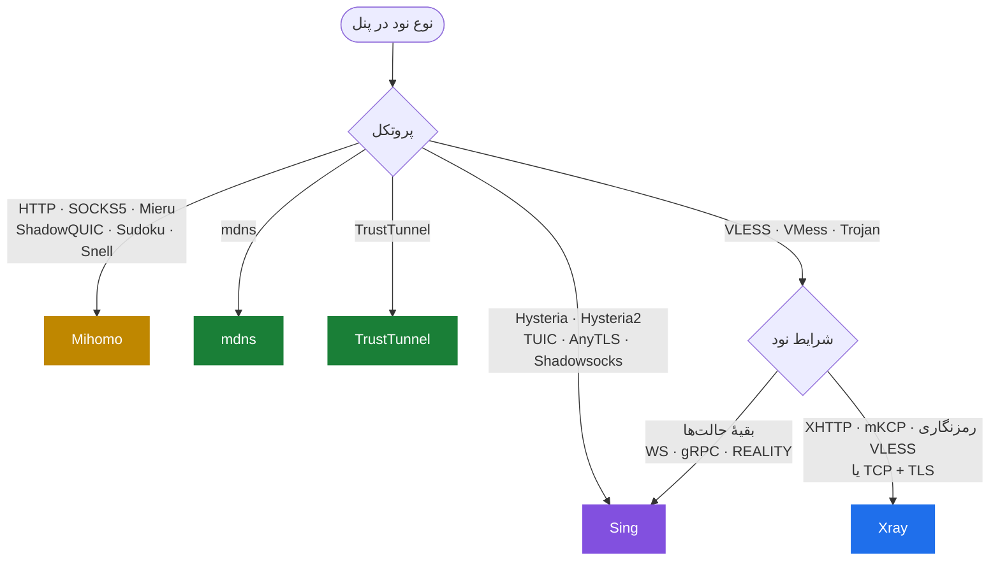

<div align="center">

# V2bX

**سرویس نود چندهسته‌ای برای پنل‌های Irboard و V2board**

A multi-core node server for Irboard and V2board panels

[](https://github.com/PoriyaVali/V2bX/releases)
[](https://github.com/PoriyaVali/V2bX/actions)
[](LICENSE)

[معرفی](#-معرفی) · [نصب](#-نصب) · [امکانات](#-امکانات) · [هسته و پروتکل](#-هسته-و-پروتکل) · [DNS هوشمند](#-dns-هوشمند) · [تنظیمات](#-تنظیمات) · [دستورها](#-دستورها) · [English](#-english)

</div>

---

<div dir="rtl">

## 📖 معرفی

این برنامه روی سرور نود نصب می‌شود، تنظیمات نود و فهرست کاربران را از پنل می‌گیرد و مصرف هر کاربر را به پنل گزارش می‌کند.

- **شش هسته در یک برنامه:** Xray، Sing، Mihomo، Hysteria2، mdns و TrustTunnel. هر نود روی هسته‌ای اجرا می‌شود که برای پروتکلش مناسب‌تر است و نودهای چند هسته کنار هم روی یک سرور کار می‌کنند.
- **آزموده با کلاینت واقعی:** هر نوعی از نود که فرم‌های Irboard می‌سازند، روی هر هسته‌ای که آن را سرویس می‌دهد، با کلاینت‌های Mihomo، sing-box و Xray آزموده می‌شود: اتصال، صورت‌حساب، حذف کاربر و محدودیت سرعت.
- **منشعب از** [wyx2685/V2bX](https://github.com/wyx2685/V2bX)، با هسته‌های به‌روز و منوی فارسی و انگلیسی.

## 🚀 نصب

### نصب سریع

این دستور را با دسترسی root اجرا کنید:

<div dir="ltr">

```bash
bash <(curl -Ls https://raw.githubusercontent.com/PoriyaVali/V2bX/dev_new/install.sh) setup
```

</div>

اگر V2bX از قبل نصب باشد، به‌روزرسانی می‌کند؛ وگرنه نصب کامل انجام می‌دهد و ویزارد تنظیم را باز می‌کند. ویزارد فقط چهار چیز می‌پرسد: آدرس پنل، کلید ارتباط (API Key)، شناسهٔ نود و هسته. نوع پروتکل، TLS و دامنه را خودش از پنل می‌خواند. جزئیات در [راهنمای ویزارد](docs/automated-setup.md).

### به‌روزرسانی و برگشت نسخه

<div dir="ltr">

```bash
v2bx update           # آخرین نسخه
v2bx update 1.12.3    # یک نسخهٔ مشخص، برای برگشت به عقب هم
```

</div>

- فایل‌های تنظیم و گواهی‌ها دست نمی‌خورند.
- سرویسِ روشن دوباره راه‌اندازی می‌شود و سرویسِ خاموش، خاموش می‌ماند.
- اگر دانلود ناقص باشد یا نسخه پیدا نشود، نسخهٔ نصب‌شده تغییری نمی‌کند.

### نصب دستی

<details>
<summary>گام‌به‌گام، بدون اسکریپت نصب</summary>

#### گام ۱: دانلود

فایل مناسب معماری سرور را از [صفحهٔ انتشارها](https://github.com/PoriyaVali/V2bX/releases/latest) بردارید:

| معماری (`uname -m`) | فایل |
|---|---|
| `x86_64` | `V2bX-linux-64.zip` |
| `aarch64` | `V2bX-linux-arm64-v8a.zip` |
| `armv7l` | `V2bX-linux-arm32-v7a.zip` |
| `riscv64` | `V2bX-linux-riscv64.zip` |
| `s390x` | `V2bX-linux-s390x.zip` |

<div dir="ltr">

```bash
mkdir -p /usr/local/V2bX /etc/V2bX
wget -O /tmp/V2bX.zip https://github.com/PoriyaVali/V2bX/releases/latest/download/V2bX-linux-64.zip
unzip -o /tmp/V2bX.zip -d /usr/local/V2bX
chmod +x /usr/local/V2bX/V2bX
ln -sf /usr/local/V2bX/V2bX /usr/bin/v2bx
```

</div>

#### گام ۲: فایل تنظیم

ساده‌ترین راه اجرای ویزارد است: `v2bx configure`. برای نوشتن دستی، این نمونه را در `/etc/V2bX/config.json` بگذارید و فایل‌های `sing_origin.json`، `dns.json` و `route.json` را از پوشهٔ [example](example/) به `/etc/V2bX` کپی کنید:

<div dir="ltr">

```json
{
  "Log": { "Level": "info" },
  "Cores": [
    { "Type": "sing", "OriginalPath": "/etc/V2bX/sing_origin.json" }
  ],
  "Nodes": [
    {
      "Core": "sing",
      "ApiHost": "https://panel.example.com",
      "ApiKey": "YOUR_PANEL_API_KEY",
      "NodeID": 1,
      "NodeType": "vless",
      "ListenIP": "0.0.0.0",
      "CertConfig": {
        "CertMode": "http",
        "CertDomain": "node.example.com",
        "CertFile": "/etc/V2bX/node.example.com.crt",
        "KeyFile": "/etc/V2bX/node.example.com.key"
      }
    }
  ]
}
```

</div>

#### گام ۳: سرویس systemd

<div dir="ltr">

```bash
cat > /etc/systemd/system/V2bX.service <<'EOF'
[Unit]
Description=V2bX Service
After=network.target nss-lookup.target

[Service]
User=root
WorkingDirectory=/usr/local/V2bX
CapabilityBoundingSet=CAP_NET_ADMIN CAP_NET_BIND_SERVICE
AmbientCapabilities=CAP_NET_ADMIN CAP_NET_BIND_SERVICE
ExecStart=/usr/local/V2bX/V2bX server -c /etc/V2bX/config.json
Restart=on-failure
RestartSec=5s
LimitNOFILE=1048576

[Install]
WantedBy=multi-user.target
EOF
systemctl daemon-reload
systemctl enable --now V2bX
```

</div>

#### گام ۴: بررسی

دستور `v2bx status` وضعیت سرویس و `v2bx log` گزارش آن را نشان می‌دهد. چون دستور `v2bx` همان باینری است، منو و همهٔ دستورها با پیوند گام ۱ در دسترس‌اند.

نودهای TrustTunnel به برنامهٔ endpoint جدا هم نیاز دارند که اسکریپت نصب خودش دانلود می‌کند.

</details>

### ساخت از سورس

<details>
<summary>با Go 1.27.1</summary>

<div dir="ltr">

```bash
git clone https://github.com/PoriyaVali/V2bX.git && cd V2bX
GOEXPERIMENT=jsonv2 go build -v -o V2bX \
  -tags "sing xray hysteria2 with_quic with_grpc with_utls with_wireguard with_acme with_gvisor mdns trusttunnel mihomo" \
  -trimpath -ldflags "-s -w -buildid="
```

</div>

</details>

## ✨ امکانات

### کاربران و مصرف

- **صورت‌حساب دقیق:** مصرف هر کاربر به پنل گزارش می‌شود، حتی ترافیکی که درست پیش از حذف کاربر مصرف شده است.
- **قطع کاربر حذف‌شده:** اتصال‌های باز کاربری که پنل حذف می‌کند هم بسته می‌شود.
- **محدودیت سرعت** برای هر کاربر و هر نود، روی آپلود و دانلود.
- **محدودیت دستگاه و اتصال** برای هر کاربر، و گزارش دستگاه‌های آنلاین.
- **تغییر کاربران بدون قطع دیگران:** افزودن و حذف کاربر اتصال بقیه را قطع نمی‌کند.

### امنیت و فیلترینگ

- **قوانین پنل** (دامنه، آدرس، پورت و پروتکل مسدود) روی هر اتصال و هر بستهٔ UDP.
- **مسدودسازی آدرس‌های خصوصی:** کاربر به سرویس‌های خود سرور و شبکهٔ داخلی آن نمی‌رسد.
- **سایت پوششی:** کاوشگر یک سایت واقعی می‌بیند، نه خطای پروکسی. ([توضیحات](docs/censorship-countermeasures.md) · [امنیت سایت پوششی](docs/cover-site-security.md))
- **مسدودسازی کشور** با GeoIP روی هستهٔ Sing.

### شبکه و پایداری

- **گواهی TLS خودکار:** صدور و تمدید با HTTP یا DNS، و جایگزینی گواهی بدون قطع نود.
- **DNS هوشمند:** اگر UDP سرور بسته گم کند، پرس‌وجوهای DNS خودکار روی TCP می‌روند. ([بخش DNS هوشمند](#-dns-هوشمند))
- **بارگذاری دوبارهٔ خودکار** با تغییر فایل تنظیم.
- **مناسب شبکه‌های ضعیف**، با کنترل مصرف حافظه. ([توضیحات](docs/performance-stability.md))

### راه‌اندازی و نگهداری

- **ویزارد دوزبانه** که نوع نود را از پنل می‌خواند و هسته را خودش انتخاب می‌کند.
- **چند نود و چند هسته** در یک برنامه.
- **به‌روزرسانی امن:** نسخهٔ جدید فقط پس از دانلود و بررسی کامل جایگزین می‌شود.
- **خروجی metrics** به قالب Prometheus، به‌دلخواه.

## 🧩 هسته و پروتکل

### ۱. شش هسته در یک نگاه

| هسته | بر پایهٔ | پروتکل‌ها | ویزارد کِی انتخابش می‌کند |
|---|---|---|---|
| **Xray** | xray-core | VLESS · VMess · Trojan · Shadowsocks | XHTTP، mKCP، رمزنگاری VLESS، و VLESS یا Trojan روی TCP + TLS |
| **Sing** | sing-box | VLESS · VMess · Trojan · Shadowsocks · Hysteria · Hysteria2 · TUIC · AnyTLS | بیشتر نودها |
| **Mihomo** | mihomo | ۱۳ پروتکل، از جمله HTTP · SOCKS5 · Mieru · ShadowQUIC · Sudoku · Snell | پروتکل‌هایی که فقط Mihomo دارد |
| **Hysteria2** | سرور رسمی Hysteria2 | Hysteria2 | هیچ‌وقت؛ خودتان باید انتخابش کنید |
| **mdns** | MasterDnsVPN | تونل DNS | نودهای mdns |
| **TrustTunnel** | endpoint رسمی TrustTunnel، به‌صورت برنامهٔ جدا | TrustTunnel | نودهای TrustTunnel |

### ۲. انتخاب خودکار هسته

اگر در ویزارد هسته را روی `auto` بگذارید، این مسیر را می‌رود:

<div dir="ltr">



</div>

اگر نودی را روی هسته‌ای بگذارید که آن را سرویس نمی‌دهد، ویزارد همان لحظه می‌گوید و هسته‌های ممکن را نام می‌برد.

### ۳. پروتکل‌ها در هر هسته

⭐ دارد و ویزارد خودکار همین را انتخاب می‌کند · ✅ دارد · ➖ ندارد

| پروتکل | Xray | Sing | Mihomo | Hysteria2 | mdns | TrustTunnel | شرط |
|---|:-:|:-:|:-:|:-:|:-:|:-:|---|
| **VLESS** | ✅ | ⭐ | ✅ | ➖ | ➖ | ➖ | جدول ۴ را ببینید |
| **VMess** | ✅ | ⭐ | ✅ | ➖ | ➖ | ➖ | جدول ۴ را ببینید |
| **Trojan** | ✅ | ⭐ | ✅ | ➖ | ➖ | ➖ | روی TCP + TLS ویزارد Xray را برمی‌دارد |
| **Shadowsocks** | ✅ | ⭐ | ➖ | ➖ | ➖ | ➖ | شامل Shadowsocks 2022 |
| **Hysteria2** | ➖ | ⭐ | ✅ | ✅ | ➖ | ➖ | |
| **Hysteria (v1)** | ➖ | ⭐ | ➖ | ➖ | ➖ | ➖ | |
| **TUIC** | ➖ | ⭐ | ✅ | ➖ | ➖ | ➖ | |
| **AnyTLS** | ➖ | ⭐ | ✅ | ➖ | ➖ | ➖ | |
| **HTTP · SOCKS5** | ➖ | ➖ | ⭐ | ➖ | ➖ | ➖ | نود مدیریت‌شده در Irboard |
| **Mieru** | ➖ | ➖ | ⭐ | ➖ | ➖ | ➖ | روی TCP یا UDP |
| **ShadowQUIC** | ➖ | ➖ | ⭐ | ➖ | ➖ | ➖ | برای HTTP/3 «UDP روی stream» را روشن کنید |
| **Sudoku** | ➖ | ➖ | ⭐ | ➖ | ➖ | ➖ | |
| **Snell** | ➖ | ➖ | ⭐ | ➖ | ➖ | ➖ | با ShadowTLS v3 |
| **TrustTunnel** | ➖ | ➖ | ✅ | ➖ | ➖ | ⭐ | [نکات TrustTunnel](#۷-نکات-trusttunnel) |
| **تونل DNS** | ➖ | ➖ | ➖ | ➖ | ⭐ | ➖ | [نکات mdns](#۶-نکات-mdns) |

### ۴. انتقال و امنیت برای VLESS و VMess

| انتقال یا امنیت | Xray | Sing | Mihomo |
|---|:-:|:-:|:-:|
| TCP | ✅ | ✅ | ✅ |
| WebSocket | ✅ | ✅ | ✅ |
| gRPC | ✅ | ✅ | ✅ |
| HTTPUpgrade | ✅ | ✅ | ➖ |
| XHTTP | ✅ | ➖ | ➖ |
| mKCP | ✅ | ➖ | ➖ |
| TCP با هدر HTTP (پیش‌فرض فرم VMess) | ✅ | ➖ | ➖ |
| HTTP/2 و QUIC | ➖ | ✅ | ➖ |
| TLS | ✅ | ✅ | ✅ |
| REALITY | ✅ | ✅ | ➖ |
| Vision (`xtls-rprx-vision`) | ✅ | ✅ | ✅ |
| رمزنگاری VLESS | ✅ | ➖ | ➖ |
| ECH | ✅ | ✅ | ➖ |

### ۵. امکانات مدیریتی در هر هسته

✅ دارد · 🟡 با محدودیت (یادداشت زیر جدول) · ➖ ندارد · ❔ آزموده نشده

| امکان | Xray | Sing | Mihomo | Hysteria2 | mdns | TrustTunnel |
|---|:-:|:-:|:-:|:-:|:-:|:-:|
| گزارش مصرف هر کاربر | ✅ | ✅ | ✅ | ✅ | ✅ | ✅ |
| ردِ کاربر حذف‌شده | ✅ | ✅ | ✅ | ✅ | ✅ | ✅ |
| بستن اتصال‌های باز کاربر حذف‌شده | ✅ | ✅ | ✅ | ✅ | ✅ | ❔ |
| محدودیت سرعت | ✅ | ✅ | ✅ | ✅ | ✅ | ➖ |
| محدودیت دستگاه و دستگاه‌های آنلاین | ✅ | ✅ | ✅ | ✅ | ✅ | ➖ |
| تغییر کاربران بدون قطع دیگران | ✅ | ✅ | 🟡 | ✅ | ✅ | ✅ |
| قوانین مسدودسازی پنل | ✅ | ✅ | ✅ | ✅ | ➖ | ➖ |
| مسدودسازی آدرس‌های خصوصی | ✅ | ✅ | ✅ | ✅ | ✅ | ✅ |
| مسیرها و DNS سفارشی پنل | ✅ | ➖ | ➖ | ➖ | ➖ | ➖ |
| DNS هوشمند | ✅ | ✅ | ✅ | ✅ | ✅ | 🟡 |
| آزمون سرتاسری با کلاینت واقعی | ✅ | ✅ | ✅ | ✅ | ➖ | ➖ |

- **هستهٔ Mihomo:** پروتکل‌های HTTP، SOCKS5، Mieru، ShadowQUIC، Sudoku و Snell کاربران را درجا تغییر می‌دهند. پروتکل‌های دیگرش، از جمله TrustTunnel روی Mihomo، با هر تغییر در فهرست کاربران listener نود را از نو می‌سازند و همهٔ کاربران آن نود دوباره وصل می‌شوند.
- **هستهٔ TrustTunnel:** endpoint رسمی با کتابخانهٔ C سیستم resolve می‌کند. اگر هنگام شروع آن UDP خراب تشخیص داده شده باشد، DNS هوشمند فقط آن را به پرسیدن با TCP وامی‌دارد.
- **جزئیات** هستهٔ Mihomo در [راهنمای Mihomo](docs/mihomo-server.md) است.

### ۶. نکات mdns

هستهٔ mdns ترافیک کاربر را داخل پرس‌وجوهای DNS می‌برد، با [MasterDnsVPN](https://github.com/PoriyaVali/MasterDnsVPN). برای شبکه‌هایی ساخته شده که جز DNS تقریباً همه‌چیز در آن‌ها بسته است. سرعتش از پروتکل‌های دیگر کمتر است، ولی وقتی هیچ راه دیگری کار نمی‌کند، کار می‌کند.

- **دامنه:** یک یا چند دامنه که در پنل برای نود تعریف می‌شود و پرس‌وجوهایش باید به همین سرور برسد، معمولاً با رکورد NS.
- **پورت:** پورت UDP نود (معمولاً 53) باید روی آدرس عمومی سرور باز و آزاد باشد.
- **گواهی:** لازم نیست؛ کلید رمزنگاری و رمز نود را پنل می‌فرستد.
- **سرور DNS محلی:** اگر روی همین سرور Unbound یا مشابه آن دارید، باید فقط روی `127.0.0.1:53` گوش دهد و `ListenIP` نود mdns آدرس عمومی سرور باشد؛ وگرنه هر دو پورت 53 را می‌خواهند.

### ۷. نکات TrustTunnel

این پروتکل روی دو هسته اجرا می‌شود. ستون TrustTunnel در جدول ۵ مربوط به هستهٔ TrustTunnel است؛ اگر TrustTunnel را روی Mihomo اجرا کنید، امکانات ستون Mihomo را دارد.

- **هستهٔ TrustTunnel** (انتخاب خودکار ویزارد): برنامهٔ رسمی endpoint. تغییر کاربران هیچ اتصالی را قطع نمی‌کند، ولی محدودیت سرعت، محدودیت دستگاه و قوانین پنل ندارد. برنامهٔ endpoint را اسکریپت نصب دانلود می‌کند.
- **هستهٔ Mihomo:** همهٔ آن محدودیت‌ها و قوانین را دارد، ولی با هر تغییر در فهرست کاربران همهٔ کاربران نود یک لحظه قطع و دوباره وصل می‌شوند. برای انتخابش در تنظیم نود `"Core": "mihomo"` بگذارید.

### ۸. نسخهٔ هسته‌ها

| هسته | نسخه |
|---|---|
| xray-core | v26.9.9 (fork: `v1.260909.1`) |
| sing-box | v1.13.21 (fork: `v1.13.21-v2bx.2`) |
| Mihomo | v1.19.32 (fork: `3de39671cc05`) |
| Hysteria2 | v2.11.0 |
| MasterDnsVPN | fork: `98b6fbffd1b4` |
| TrustTunnel endpoint | آخرین انتشار [fork](https://github.com/PoriyaVali/TrustTunnel) |

## 🌐 DNS هوشمند

روی سرورهایی که بسته‌های UDP را گم می‌کنند، هر پرس‌وجوی DNS گم‌شده یعنی چند ثانیه انتظار برای کاربر. V2bX یک DNS داخلی دارد که همهٔ هسته‌ها از آن استفاده می‌کنند:

- **مسابقهٔ UDP و TCP:** پرس‌وجو با UDP می‌رود؛ اگر جواب دیر کند، همان پرس‌وجو با TCP هم فرستاده می‌شود و اولین جواب پذیرفته می‌شود.
- **تشخیص خرابی:** با گم شدن دست‌کم ۳ پرس‌وجو و ۵٪ از ۵۰ پرس‌وجوی آخر، آن resolver فقط با TCP پرسیده می‌شود. پس از ۵۰ آزمایش موفق پشت‌سرهم به UDP برمی‌گردد.
- **حافظهٔ پاسخ:** جواب‌ها به اندازهٔ TTL خودشان نگه داشته می‌شوند.
- **بی‌دردسر:** پورت 53 را نمی‌گیرد و `/etc/resolv.conf` را تغییر نمی‌دهد. اگر resolver محلی مثل Unbound دارید، کنار می‌ایستد.

تنظیم لازم ندارد. برای تغییر رفتارش، در `config.json`:

<div dir="ltr">

```json
{ "DNS": { "Mode": "auto", "Servers": ["1.1.1.1", "9.9.9.9"] } }
```

</div>

مقدار `Mode` یکی از `auto` (پیش‌فرض)، `tcp` (همیشه TCP) یا `system` (خاموش) است. جزئیات در [راهنمای DNS هوشمند](docs/smart-dns.md).

## 🔧 تنظیمات

فایل اصلی `/etc/V2bX/config.json` است. ساده‌ترین راه ساختنش ویزارد است (`v2bx configure`)؛ نمونه‌ها در پوشهٔ [example](example/) هستند.

| بخش | کار |
|---|---|
| `Log` | سطح و مقصد گزارش‌ها |
| `Cores` | هسته‌هایی که اجرا می‌شوند و تنظیم هر کدام |
| `Nodes` | نودها: آدرس پنل، کلید، شناسه، هسته و گواهی |
| `DNS` | [DNS هوشمند](#-dns-هوشمند) |
| `Metrics` | آدرس اختیاری metrics برای Prometheus |
| `Memory` | سقف مصرف حافظه |

## 💻 دستورها

| دستور | کار |
|---|---|
| `v2bx menu` | منوی مدیریت |
| `v2bx start` · `stop` · `restart` | روشن، خاموش و راه‌اندازی دوبارهٔ سرویس |
| `v2bx status` · `log` | وضعیت و گزارش سرویس |
| `v2bx update [نسخه]` | به‌روزرسانی، یا نصب یک نسخهٔ مشخص |
| `v2bx version` | نسخهٔ نصب‌شده |
| `v2bx configure` | ویزارد تنظیم نود از روی پنل |
| `v2bx edit` · `check` | ویرایش و بررسی فایل تنظیم |
| `v2bx cert` | تاریخ انقضای گواهی‌ها |
| `v2bx x25519` | ساخت کلید برای REALITY |
| `v2bx bbr` | روشن کردن BBR |
| `v2bx synctime` | هماهنگ کردن ساعت سرور |
| `v2bx uninstall` | حذف |

## 📚 مستندات

- [ویزارد و تنظیم خودکار](docs/automated-setup.md)
- [DNS هوشمند](docs/smart-dns.md)
- [هستهٔ Mihomo](docs/mihomo-server.md)
- [مقابله با فیلترینگ و سایت پوششی](docs/censorship-countermeasures.md)
- [پایداری و کارایی](docs/performance-stability.md)
- [بررسی نودهای Irboard روی همهٔ هسته‌ها](docs/served-nodes-review-2026-11-07.md)
- [بررسی صورت‌حساب، حذف کاربر و محدودیت سرعت](docs/billing-and-removal-review-2026-11-12.md)
- [یادداشت‌های هر نسخه](docs/releases/)

</div>

---

## 🌍 English

V2bX runs on a node server. It takes the node's settings and user list from an Irboard or V2board panel and reports each user's traffic back. One binary carries six cores: Xray, sing-box, Mihomo, Hysteria2, mdns and TrustTunnel. Each node runs on the core that suits its protocol, and nodes on different cores run side by side.

**Install or update** as root:

```bash
bash <(curl -Ls https://raw.githubusercontent.com/PoriyaVali/V2bX/dev_new/install.sh) setup
```

Afterwards, `v2bx menu` manages the service and `v2bx update` upgrades it (`v2bx update 1.12.3` installs a given version). The manual installation steps above use the same commands in any language.

**Highlights**

- Per-user accounting, speed limits, device limits, and cut-off of removed users.
- Panel block rules and a private-address block, applied to every connection and every UDP datagram.
- A built-in DNS forwarder that switches to TCP while UDP queries are being lost ([docs/smart-dns.md](docs/smart-dns.md)).
- Automatic TLS certificates, a cover site for active probes, and hot config reload.
- Every node type the panel creates is tested end to end on every core that serves it, with Mihomo, sing-box and Xray clients.

**Cores.** Tables 3 to 5 above show which protocols, transports and management features each core has. Two cores differ from the rest:

- **mdns** carries traffic inside DNS queries. It needs a domain delegated to the server and the node's UDP port (usually 53). It has accounting, speed and device limits, and the private-address block, but no panel rules.
- **TrustTunnel** runs on its own core (the official endpoint) or on Mihomo. The TrustTunnel core never disconnects users on a user-list change, but has no speed limit, device limit or panel rules. Mihomo has all of those, but reconnects every user of the node on each user-list change.

## Credits

[wyx2685/V2bX](https://github.com/wyx2685/V2bX) · [XTLS](https://github.com/XTLS/) · [sing-box](https://github.com/SagerNet/sing-box) · [mihomo](https://github.com/MetaCubeX/mihomo) · [hysteria](https://github.com/apernet/hysteria) · [XrayR](https://github.com/XrayR/XrayR) · [V2Fly](https://github.com/v2fly)

## Disclaimer

Provided as-is with no warranty. Use at your own risk.

بدون هیچ ضمانتی ارائه می‌شود؛ مسئولیت استفاده با کاربر است.
